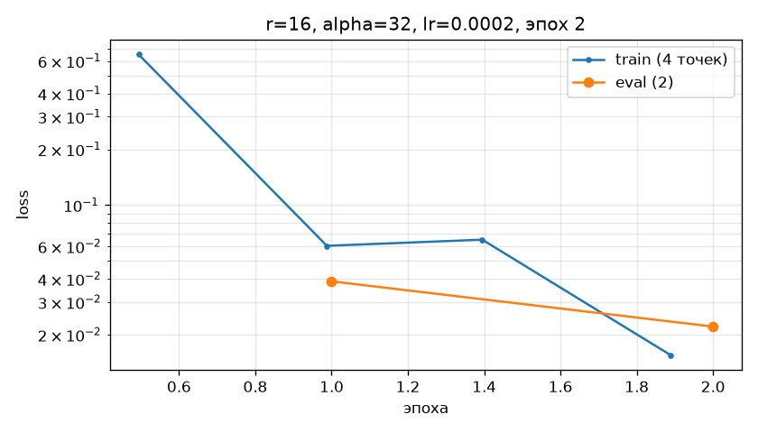

# ECQL: дообучение малой LLM на правилах

Перевод запросов в DSL **ECQL** - QLoRA поверх Qwen3-4B.
Запросы к документу идут через HTTP.
## Состав

```
ecql_lora.py     ОБУЧЕНИЕ: загрузка в 4 битах, LoRA, данные, обучение
server.py        HTTP: вопрос -> модель -> ECQL -> строки документа
ask.py           инференс: загрузка модели, перевод, чтение документа
ecql.py          грамматика ECQL: разбор запроса и исполнение

datasets/
  ecql_dataset_rules.xlsx   правила, схема, справочники
  ecql_shop_test.xlsx       CUSTOMERS, PRODUCTS, ORDERS, DELIVERIES
outputs/ecql-lora/          создаётся обучением
  adapter_model.safetensors   веса LoRA
  adapter_config.json         целевые модули
  system_prompt.txt           промпт, который подаётся модели
  loss_curve.png              кривая обучения: train и eval
  log_history.json            та же история числами
```

```bash
pip install -r requirements.txt

python ecql_lora.py --prompt       # системный промпт, собранный из книги правил
python ecql_lora.py --train        # дообучение
```

Обучение читает `datasets/ecql_dataset_rules.xlsx`: 180 пар запрос ->
ECQL с листа "Датасет", правила с листа "Соглашения", схему и коды с листов
"Схема" и "Справочники". Правила и схема идут в системный промпт, пары - в
обучающие примеры. Каждый 10-й пример уходит в валидацию.

### Кривая обучения

После обучения сохраняются `outputs/ecql-lora/loss_curve.png` и
`log_history.json`: train loss (каждые 5 шагов) и eval_loss (в конце эпохи), по
оси X - эпоха, шкала loss логарифмическая. На фактическом прогоне train
0.651 -> 0.0155, eval 0.0388 -> 0.0221; обе кривые к концу ещё падают - значит
эпох можно добавить.



График строит `matplotlib`; если его нет, а кривую можно построить потом из `log_history.json`:

## Инференс по HTTP

```bash
python server.py
```

### Маршруты

| Маршрут | Что делает |
|---|---|
| `GET /health` | устройство, dtype, таблицы документа |
| `GET /ask?q=<вопрос>&limit=20` | вопрос → ECQL → строки документа |

Коды справочников

| Сущность | Коды | Числа | Даты | Строки |
|---|---|---|---|---|
| `CUSTOMERS` | `@segment` `@status` `@subscription` | `@age` `@orders_count` `@total_spent` `@bonus_points` | `@registration_date` | `@name` `@city` |
| `PRODUCTS` | `@category` `@status` | `@price` `@stock` `@rating` `@discount` | `@added_date` | `@title` `@brand` |
| `ORDERS` | `@status` `@payment_method` | `@amount` `@items_count` | `@order_date` | `@customer` `@city` `@promo_code` |
| `DELIVERIES` | `@method` `@status` | `@cost` `@weight` `@days` | `@delivery_date` | `@courier` `@city` |

Допустимые значения кодов печатает `python ecql_lora.py --prompt` - тот же
системный промпт, который видит модель.
